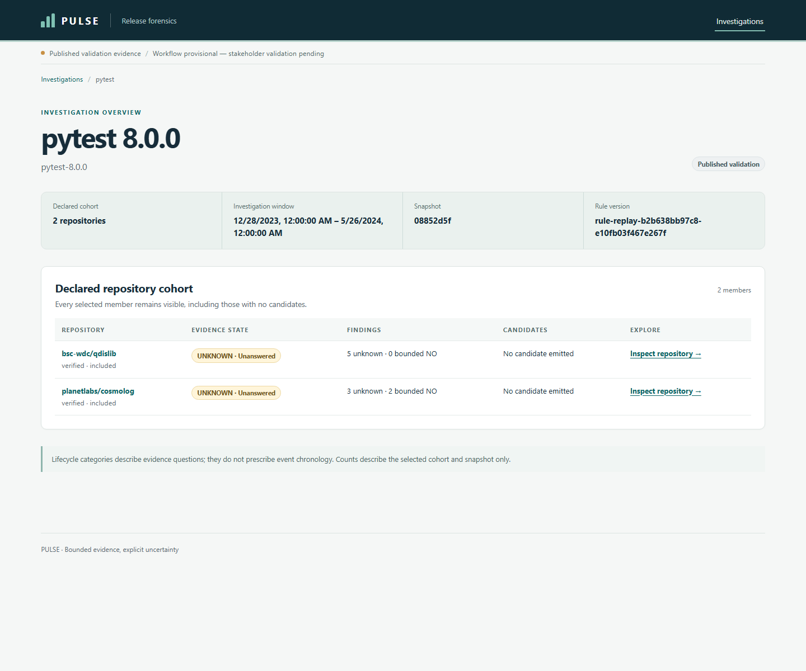
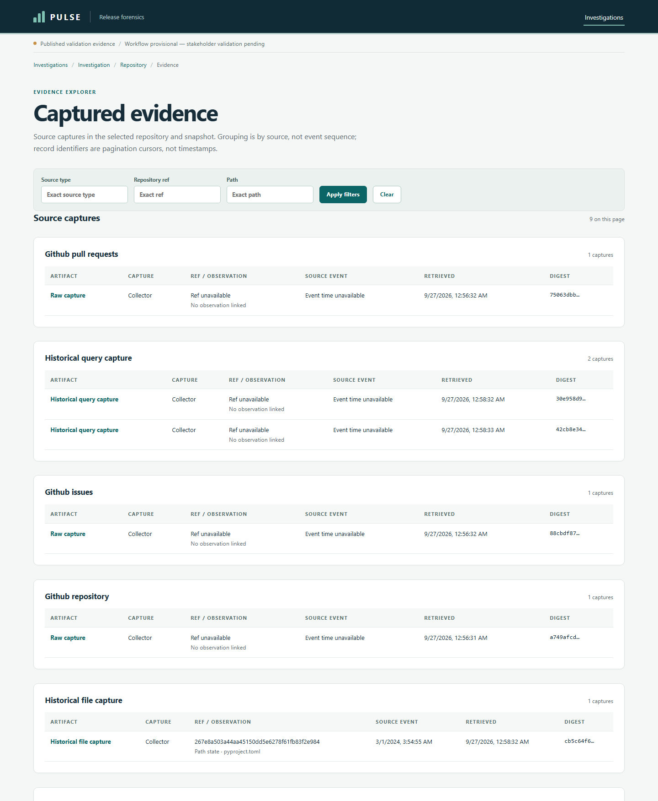
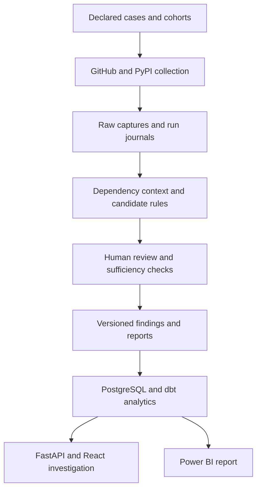

# PULSE — Dependency Release Investigation

PULSE investigates public evidence surrounding a dependency release across a declared set of downstream repositories. It preserves source provenance, separates automated candidates from reviewed evidence, and makes missing or insufficient evidence visible in reports, analytics, and an interactive investigation interface.

**Status:** working local prototype with bounded technical validation and partial stakeholder validation. The implementation on this branch includes the collection engine, PostgreSQL/dbt analytics, Power BI project, React/FastAPI interface, and an isolated evidence-depth experiment. See the [repository audit](docs/audits/2026-10-17-project-briefing.md) for commit-pinned evidence and claim boundaries.

> **Audit scope:** the October 17, 2026 audit inspected the cumulative implementation at commit `49dbbae`. This integration brings that implementation, the evidence briefing, and this README into `main`. The briefing preserves the repository state observed before integration.

## Why PULSE exists

A dependency update can leave evidence scattered across manifests, issues, pull requests, commits, and release notes. A declaration may show that a version is permitted without proving that it was installed. A bot pull request may quote upstream breakage without demonstrating a downstream incident.

PULSE organizes these records into a bounded investigation: which repositories were selected, what was collected, what a rule flagged, what review accepted, and which questions remain unanswered.

Lifecycle categories—adoption readiness, observed adoption, migration friction, remediation, and recovery signals—are investigative questions. They are not an assumed chronological or causal sequence.

## Investigation interface

The local application provides seven screens: investigation list, investigation overview, repository detail, evidence explorer, finding detail, candidate detail, and artifact provenance. Detail routes retain an explicit case and snapshot.





See the [product screenshots](docs/phase-5/m5-4/screenshots/README.md) and [technical acceptance results](docs/phase-5/m5-4/product-acceptance-results.md). Published investigation pages are read-only. A guarded DRAFT review contract exists in the backend; an authorized real DRAFT review workflow has not been demonstrated.

## What is implemented

| Capability | Implementation |
| --- | --- |
| Declared investigations | Typed YAML cases, explicit observation windows, frozen cohorts, and selection records |
| Evidence collection | GitHub and PyPI collectors; authenticated GitHub pagination, bounded retries, explicit task outcomes, and verified whole-task resume |
| Provenance | Raw capture envelopes, capture method, task/run identity, content hashes, and separate source/retrieval clocks |
| Dependency context | Manifest parsing and exact-ref, path-scoped historical reconstruction with unresolved states |
| Detection and review | Transparent text/constraint rules generate candidates; explicit review controls acceptance |
| Findings and reporting | Stage-specific sufficiency, UNKNOWN propagation, denominator-aware metrics, JSON and Markdown reports |
| Analytics | PostgreSQL migrations and governed loading; dbt staging, intermediate models and marts; versioned metrics and replay publication |
| Product surfaces | Snapshot-scoped FastAPI reads, React/TypeScript investigation interface, and Power BI report/semantic model |
| Evidence-depth experiment | Separately versioned Phase 7 reconstruction and offline evaluation without replacing the published baseline |

## Architecture



The stack uses Python, Pydantic, HTTPX, PostgreSQL, dbt, FastAPI, React, TypeScript, Vite, and Power BI. Rules are deterministic; the implemented detection approach does not use ML or an LLM.

## Validation results

The following populations must be kept separate.

| Validation | Observed or recorded result | Interpretation |
| --- | --- | --- |
| Phase 1 HTTPX 0.28.0 | One downstream repository; three candidates, two accepted and one rejected | Connector-assisted demonstration of friction/remediation; collection was incomplete |
| Phase 2 automated baseline | Two cases—pytest 8.0.0 and urllib3 2.0.0—covering eight downstream repositories; two candidate firings from one artifact, both rejected | Bounded collection works; zero accepted lifecycle events |
| Published analytical baseline | 40 findings: 38 UNKNOWN, two bounded NO, zero positive | Most lifecycle questions lack sufficient evidence |
| Phase 7 isolated experiment | Paired history records 1 → 5 of 16; sufficient assessments 2 → 6 of 40; UNKNOWN 38 → 34; positives remain zero | Improved historical context and question sufficiency, not adoption or recovery detection |
| Stakeholder research | Convenience sample of 14; G8 `PARTIALLY_VALIDATED` | Problem/interest evidence; workflow value and decision impact remain unvalidated |

A **bounded NO** means no qualifying evidence was found under sufficient declared sources and review. It does not prove that no event occurred. UNKNOWN is not zero adoption, successful compatibility, or recovery.

The [Phase 7 experiment](docs/phase-7/phase-7-closure.md) is separate from the published baseline. Its results are not promoted into the application or BI evidence by implication. The [task-validation pilot](docs/stakeholder-validation/task-pilot/README.md) is **PREPARED_NOT_EXECUTED**; Phase 8 is **NOT_STARTED**.

## Run locally

### Python engine and source inspection

Requirements: Python 3.12+ and [uv](https://docs.astral.sh/uv/).

```bash
uv sync --locked --all-groups
uv run pulse plan cases/httpx-0.28.0.yaml
uv run python scripts/reproduce_validation.py
```

The last command replays the committed **connector-assisted HTTPX demonstration**. It does not run live collection or reproduce the full Phase 2 analytics environment.

For live collection, copy `.env.example` to an ignored `.env`, configure `GITHUB_TOKEN` with read access to the public repositories being studied, then run:

```bash
uv run pulse collect cases/httpx-0.28.0.yaml
uv run pulse collect cases/httpx-0.28.0.yaml --resume
```

Collection preserves partial/failure outcomes and returns a nonzero status for an incomplete run. Resume reuses verified successful tasks and qualifying optional 404 probes; it is not arbitrary mid-page continuation. New collection does not replace frozen validation evidence or automatically publish findings.

### Database and analytical prerequisites

**A fresh clone is not a complete runnable dataset.** Full Phase 2 replay and database loading require four external frozen collection/history roots referenced by the [input manifest](data/manifests/phase2-postgres-load-manifest.json). The original baseline manifests also contain machine-specific Windows paths.

Follow these guides in order:

1. [Local PostgreSQL setup and migration runbook](docs/phase-4/m2-implementation/migration-runbook.md).
2. [Frozen input configuration and verification](docs/phase-4/m2-implementation/m2-2-input-manifest.md).
3. [dbt setup and reconciliation](analytics/dbt/README.md).
4. [Governed replay/publication record](docs/phase-4/milestone-4-1b-findings.md).

The PostgreSQL setup is a local Windows/PowerShell workflow. Database initialization alone does not populate the two published snapshots needed by the interface. Historical milestone documents describe their state at that time; later publication work adds migration V005.

### Investigation application

After configuring the existing local database and published validation snapshots, start the API from the repository root:

```bash
uv run uvicorn pulse.api.app:app --host 127.0.0.1 --port 8000
```

In a separate terminal:

```bash
cd frontend
npm ci
npm run dev
```

Open `http://127.0.0.1:5173`; API documentation is at `http://127.0.0.1:8000/docs`. The frontend defaults to the local API. See [backend configuration](docs/phase-5/m5-2/api-implementation.md) for the restricted local PostgreSQL settings and [frontend architecture](docs/phase-5/m5-3/frontend-architecture.md) for API-origin configuration.

The Power BI text project is [PULSE_Release_Forensics.pbip](analytics/powerbi/PULSE_Release_Forensics.pbip). It requires Power BI Desktop and the configured analytical database; see [dashboard validation](docs/phase-4/m4-2/power-bi-dashboard-validation.md).

## Quality and reproducibility

```bash
uv run ruff check .
uv run pytest -p no:cacheprovider
```

Database tests require the isolated PostgreSQL environment; without it, database probes can skip. Set `PULSE_REQUIRE_DB_TESTS=1` when database checks must fail rather than skip. See the database runbook before running them.

Frontend checks run from `frontend/`:

```bash
npm run lint
npm run typecheck
npm test
npm run build
```

Evidence available at the October 17 audit:

- **GitHub Actions confirmed:** 40 Python tests and Ruff passed on the Phase 1 `main` commit.
- **Later repository execution records:** Phase 7 reports 204 Python tests passed; M5.4 reports 11 frontend tests plus lint/typecheck/build; the analytical publication manifest records 30 dbt models and 173 test passes.
- **Replay records and tests:** hash/identity validation, deterministic reporting, candidate/review lineage, drift rejection, and 46 byte-identical metric outputs across two governed snapshots.

These are different suites and execution contexts. Later counts were not independently rerun during the audit and are not represented as later GitHub Actions results. Replay controls establish equivalence only when the required frozen inputs are available; recollecting mutable public APIs is not guaranteed to reproduce historical captures.

## Important limitations

- Two convenience cohorts do not support ecosystem-wide prevalence or unbiased dependent discovery.
- Collection completeness means completion of declared tasks, not discovery of every relevant incident.
- Exact package/version text rules can miss implicit references and flag copied upstream notes. Detector recall and broad precision remain unvalidated.
- A dependency declaration or permissive constraint does not prove installation, target-version use, or runtime compatibility.
- Accepted-positive support chains, observed-adoption rates, and recovery measurements remain unproven in the automated cases.
- Technical QA and survey interest do not establish stakeholder acceptance, time savings, ROI, production readiness, or causal impact.
- The API/interface targets a local environment; it does not provide enterprise authentication or demonstrate production scalability.

## Project evidence

| Area | Start here |
| --- | --- |
| Current evidence-backed briefing | [Repository audit](docs/audits/2026-10-17-project-briefing.md) |
| Feasibility and scope | [Phase 0 findings](docs/phase-0/phase-0-findings.md) |
| Engine demonstration | [HTTPX validation](docs/phase-1/validation-case.md) |
| Automated collection and limitations | [Phase 2 findings](docs/phase-2/phase-2-findings.md) |
| Business analysis | [Requirements and traceability findings](docs/phase-3/milestone-4-findings.md) |
| Governed analytics | [Replay publication](docs/phase-4/milestone-4-1b-findings.md) |
| Interface QA | [Product acceptance results](docs/phase-5/m5-4/product-acceptance-results.md) |
| Decision synthesis | [Phase 6 decision](docs/phase-6/phase-6-decision-record.md) |
| Evidence-depth experiment | [Phase 7 closure](docs/phase-7/phase-7-closure.md) |
| Stakeholder research | [Wave 2 assessment](docs/stakeholder-validation/wave-2/g8-assessment.md) |

The next evidence priority is to execute the prepared stakeholder task pilot and assess whether users can interpret the bounded findings and use them in a real investigation decision.
