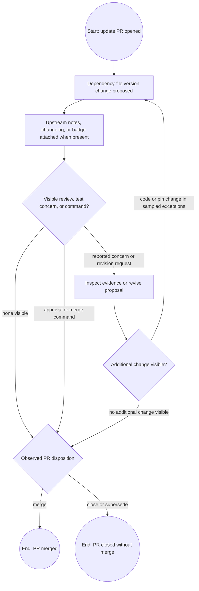

# Provisional BPMN-style public PR model

This is a textual **BPMN-style** representation of the *observed bot-initiated PR artifact path*, not formal BPMN certification or a final organizational As-Is process. Gateways represent public-record branches; “no visible concern” never means no concern existed. No organizational process owner or portfolio decision is assigned.

The model does not assert a universal test gate. [baseplate.py#1054](https://github.com/reddit/baseplate.py/pull/1054#pullrequestreview-2532549557) supports the reported-failure and code-change path; [uvicorn#2549](https://github.com/Kludex/uvicorn/pull/2549#discussion_r1900374580) supports a version-retaining revision; [baseplate.py#1045](https://github.com/reddit/baseplate.py/pull/1045#issuecomment-2573463429) supports a superseded closure. Other PRs may reach disposition without a visible discussion. Both end states are **PR states only**: neither proves migration completion, production deployment, or recovery. The broader release-investigation start event and decision gateways remain `hypothesized` until primary research.
