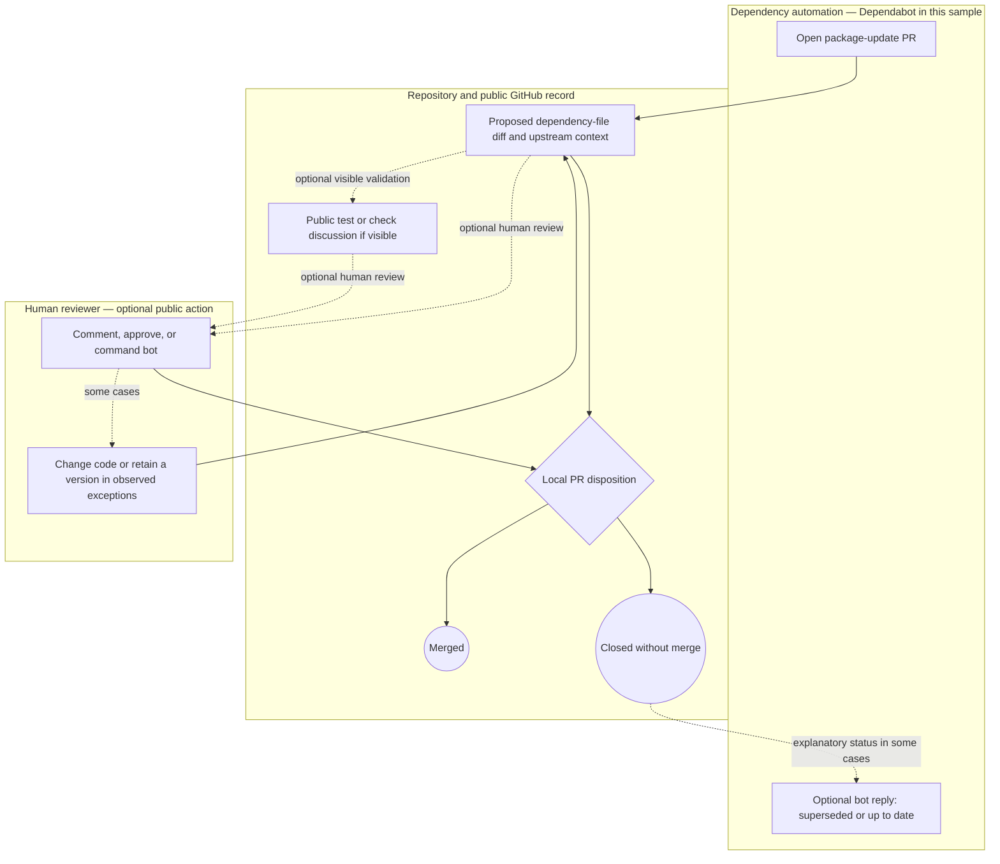

# Provisional public PR swimlane

This **secondary-evidence-supported** model describes the frozen bot-initiated public PR sample, not the general Python upgrade workflow or a stakeholder-validated As-Is process. The lanes are observable artifact/system roles, not invented organizational job titles. A dotted path is optional or incompletely visible. PULSE is deliberately absent: no evidence shows that sampled repositories used it.

The diagram does **not** assert that every PR ran visible CI, received human review, or looped through a code change. [The mypy review and code change](https://github.com/reddit/baseplate.py/pull/1054) and [the retained Uvicorn pin](https://github.com/Kludex/uvicorn/pull/2549) support the exceptional revision path. [Superseded PRs](https://github.com/reddit/baseplate.py/pull/1045) and [up-to-date closures](https://github.com/delphix/virtualization-sdk/pull/598) support separate closure explanations; a bot reply does not necessarily cause the closure.

## PULSE analytical overlay, outside the swimlane

Phase 2 PULSE can collect bounded public sources and report reviewed evidence, but its current path often cannot resolve release-time declarations, installed target versions, or recovery. That analytical overlay is documented in [the evidence model](as-is-evidence-model.md) and [capability matrix](current-state-capability-matrix.md). It is not inserted into the sampled repositories' existing workflow.
