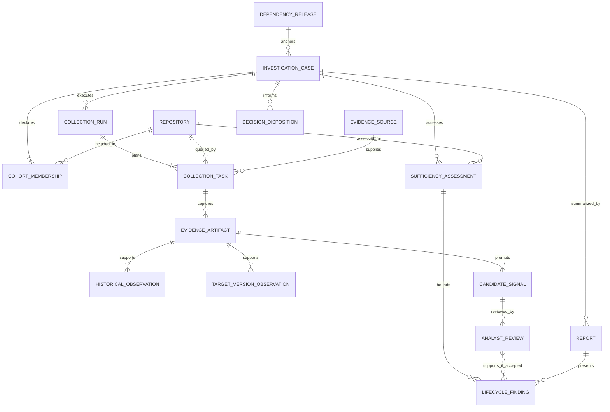

# Logical information model — provisional

This ER view names **business concepts and cardinalities**, not tables, keys, indexes, or a database choice. It follows [data requirements](data-requirements.md) and the [To-Be case](to-be-process.md). Some proposed entities (target-version observation and human disposition) have no comprehensive Phase 2 source and are not represented as implemented features.

**Interpretation:** One case has one declared release and at least one membership; a repository may appear in several independent cases. A collection task may have no artifact after failure or verified optional not-found. An artifact can support several observations/candidates but its identity is not the conclusion. A candidate may have successive review actions, though at most one terminal decision is valid for a frozen analytical baseline. A lifecycle finding may have no supporting review when it is `UNKNOWN` or a bounded no-qualifying-evidence result; a YES based on candidates requires accepted qualifying review. A report presents one case's bounded state, while a human disposition is a separate decision and never implied by a report.

`EVIDENCE_SOURCE` describes origin/type/access/capture method; `COLLECTION_TASK` records what was attempted. Historical observation, target-version observation, and finding are separate because a current declaration, release-time declaration, resolved target version, compatibility response, and production recovery answer different questions. Source and event timestamps are distinct from retrieval/report timestamps. A missing relationship or artifact is not a false observation: it can drive an explicit sufficiency/UNKNOWN state.

The diagram omits a physical “cohort table” because the declared cohort is the set of memberships under a case. It also omits an automated priority score: an optional [attention suggestion](requirements-specification.md) is a derived view over declared repositories and reasons, not a business fact. [Source mappings](source-to-target-mapping.md) specify which origins can populate these concepts.
