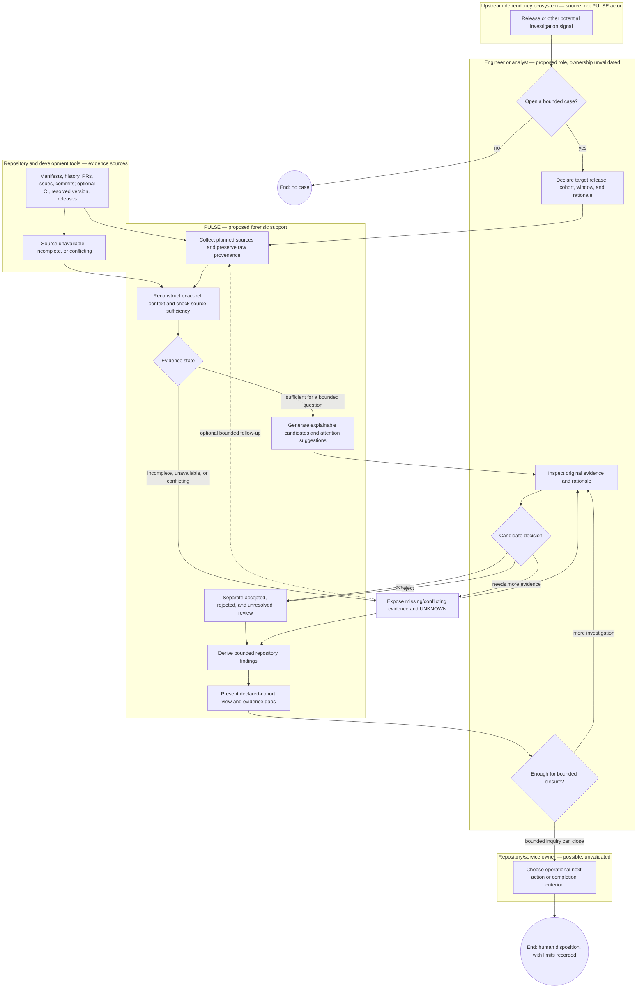

# Provisional To-Be process model

This proposed swimlane/BPMN-style flow is **pending stakeholder reconciliation**. It is not the [observed bot-PR As-Is model](as-is-bpmn.md), and it does not imply that sampled public repositories use PULSE. Solid paths describe the proposed case workflow; optional source inputs and human feedback may repeat. The repository/service owner is an **unvalidated organizational actor**. Lifecycle findings are evidence categories, not a required time sequence.

`UNKNOWN` is not a negative branch. An accepted candidate can support a bounded YES even when another source is missing; a negative finding requires its own source-specific completeness threshold. A rejected candidate never enters accepted evidence. When no candidates are emitted, the report retains the method's recall limit. A collection failure does not remove the repository from the declared cohort. The possible owner lane does not assert a current organization chart or delegate production-risk acceptance to PULSE.

The proposed feedback loop is a human request for more evidence followed by bounded reacquisition or a documented unresolved finding. It is not an autonomous remediation loop. [Human/automation boundaries](human-automation-boundary.md) specify decision ownership; [To-Be process](to-be-process.md) gives the stage and exception definitions.
