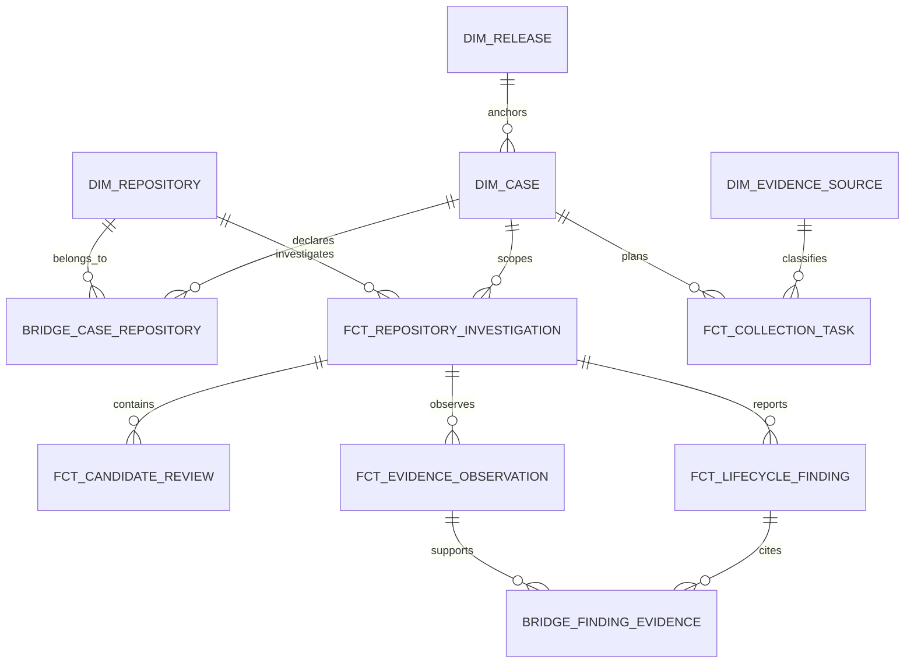

# Proposed analytical model, separate from operational evidence

[Phase 3's logical BA model](../phase-3/logical-data-model.md) describes business entities. A future PostgreSQL **core** layer would normalize case/release, frozen membership, run/task, source/artifact, historical and qualified target-version observations, candidate/review, sufficiency/finding and human disposition. It is not a star schema and never replaces raw snapshots. The **analytics** layer would materialize the grains in [analytical-grain.md](analytical-grain.md) from one verified analysis snapshot.

Dimensions use stable natural identifiers mapped to analytical keys; facts carry both keys and preserved source IDs. `analysis_snapshot_id` prevents accidental pooling of revised runs. `bridge_case_repository` holds the frozen denominator even if no task or observation row exists. `bridge_finding_evidence` carries each accepted support link and cannot convert a rejected candidate into accepted evidence. Candidate and observation facts are **not** joined directly into a flat member fact: that multiplies rows and corrupts rates. Aggregate to member or finding grain first. `dim_evidence_source` includes controlled capture method; fixtures are excluded from operational measures, connector-assisted evidence is labeled and excluded from unattended-collector success claims.

`fct_repository_investigation` supports MET-001/002/006/008; `fct_collection_task` supports MET-016–020 where audited; `fct_candidate_review` supports MET-009–011/022/023; `fct_lifecycle_finding` supports MET-004/005/012–014/021; `fct_evidence_observation` explains context and future qualified version evidence. Release and repository dimensions enable bounded segmentation, not causal comparison. Human disposition is kept separate from a forensic finding and is **future/unstated**. Physical keys, indexing, access policy, retention and performance targets await authorization and source-volume evidence.
