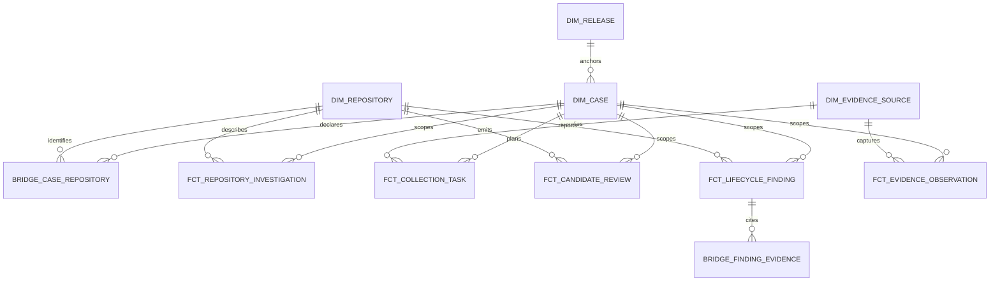

# M2.4 analytical model and publication boundary

M2.4 creates dbt-owned **tables** in `analytics` from the 12 staging and seven
intermediate views. These tables are stable for local validation and carry
`analysis_snapshot_id`, `snapshot_state` and `input_manifest_sha256`. The two
source input snapshots are **DRAFT**. Consequently all current mart rows are
validation outputs and must not be served as published BI data. The dbt build
neither changes `core.analysis_snapshot` nor publishes a new snapshot.

| Model | Grain and key | Rows | Intended use and boundary |
| --- | --- | ---: | --- |
| `dim_case` | Case definition version; `case_key = case_version_id` | 2 | Sourced release, window, plan, case/rule version; no lifecycle conclusion. |
| `dim_repository` | Stable `repository_id`; `repository_key` | 8 | Frozen represented identities; canonical name is a display label, not a key. |
| `dim_release` | Exact source `release_id`; `release_key` | 2 | Dependency package/version/release clock and original release source. |
| `dim_evidence_source` | Represented `source_id`; `source_key` | 9 | Actual provider/type/version/access class and capture-method counts. |
| `bridge_case_repository` | Input snapshot × case version × repository | 8 | Declared denominator spine; zero-evidence members remain. |
| `fct_collection_task` | Input snapshot × selected release task | 54 | Required/optional outcome, attempts, retries, capture presence. Shared upstream tasks retain NULL repository key. |
| `fct_repository_investigation` | Input snapshot × case version × repository | 8 | Preaggregated coverage and evidence-state diagnostics; not adoption, recovery or priority. |
| `fct_candidate_review` | Input snapshot × selected candidate | 2 | Firing and selected review; two firings may share one artifact. |
| `fct_lifecycle_finding` | Input snapshot × selected finding version | 40 | Literal UNKNOWN/bounded NO, source sufficiency and support diagnostics. |
| `fct_evidence_observation` | Input snapshot × typed observation on selected artifact | 11 | Declaration versus resolution, ref/path, and distinct event/retrieval clocks. |
| `bridge_finding_evidence` | Input snapshot × finding × actual typed support edge | 0 | Provenance drill-through only; empty is correct for this population. |

Dimension keys are source UUIDs because they are stable, versioned or
provider-backed identities. Facts and bridges retain both the keys and source
IDs for audit. Candidate reviews use only `snapshot_review` choices; findings
require selected assessments; tasks require selected runs; observations require
selected artifacts. No fixture artifact enters candidate or observation facts.
Finding-support edges are never invented to satisfy a join. The repository
fact aggregates candidate, finding and observation facts separately before
joining to the member spine. Its acceptance fields expose numerator and
terminally reviewed denominator separately; a zero denominator yields an
unavailable rate, not 0%.

The `analysis_snapshot_id` is a mandatory **composite scope** for fact and
bridge relationships; case/repository alone is insufficient when versions
accumulate. The `dim_evidence_source` grain is one represented source ID, not
source × method as M2-PREP proposed: tasks without captures still need a
single valid source relationship, and an uncaptured task has no true capture
method. Actual method remains on capture-bearing facts, with per-method counts
in the dimension. No synthetic method row is created. The M2-PREP proposal
also used one task per run with a snapshot-use bridge; this implementation
uses snapshot × task because each chosen run is explicitly bound by
`snapshot_run`. A future reused run would appear once per selected snapshot,
so operational task counts require an explicit snapshot filter or original
`collection_task_id` grain.

## Publication gate

The existing source rows have `state=DRAFT`, `rule_version` set to
`unrecorded_in_frozen_report`, `metric_definition_version` set to
`not_yet_modeled`, and `model_version=postgres-core-v4`. These are honest
M2.2 input descriptors, not the approved M2.4 analytical rule/metric/model
versions. The [reconciliation artifact](../../../data/validation/m2-4-mart-reconciliation.json)
records both snapshot IDs, source fingerprints, states and blocker codes.
Even after dbt tests and source digest checks pass, those missing version
contracts block publication. The DRAFT rows remain unchanged; **zero
analytical snapshots were published**.

A later publication must create a new immutable manifest/identity for each
case with approved rule, metric and model versions; exact ordered chosen
inputs and hashes; raw-byte verification; row-membership checks; passed
database/dbt/reconciliation checks; and an atomic governed state change.
Old published output must remain queryable under its original model version;
do not rebuild it silently with changed SQL. Current DRAFT validation tables
may be rebuilt and do **not** constitute that immutable published store.
This is a deliberate gate, not a claim that M2.4 published data is ready for
Power BI. See the [join guide](m2-4-join-guide.md) for safe use of these
validation tables and the [quality record](m2-4-data-quality.md) for limits.
