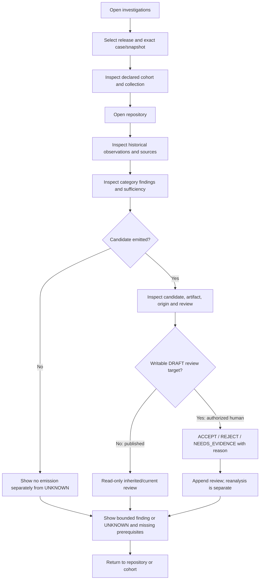

# Canonical bounded investigation workflow

**Status:** proposed; **PROVISIONAL — STAKEHOLDER VALIDATION PENDING** for the user, trigger, review burden, and usefulness. The working user is an engineer responsible for dependency upgrades or release-impact investigations across several owned repositories ([Phase 3 hypothesis](../../phase-3/primary-user-hypothesis.md)). The decision is which declared repositories warrant deeper migration/remediation investigation after a significant dependency release, and what evidence supports that attention. PULSE does not assign a risk score, causal effect, ecosystem impact, or organizational priority.

These are navigable paths, not mandatory linear steps. A user may inspect a finding without a candidate, source coverage before a repository, or return without reviewing. Lifecycle categories are forensic evidence classes, **not chronology or causality**.

| Path | Behavior and boundary |
|---|---|
| Happy path | Choose a bounded case; see all declared members; inspect repository evidence, literal findings, and recorded provenance; return to cohort. Current published replay: 2/6 members by case, 38 UNKNOWN and two bounded NO, no positive finding. |
| Uncertainty | Missing source/anchor/prerequisite remains UNKNOWN; show actual reason and an inspection route. No UNKNOWN→NO or guaranteed remedy. |
| Candidate review | Inspect exact artifact/span, rule, origin and prior decisions. Submit a reasoned review **only** on an eligible DRAFT candidate with verified human authority. Both currently published candidates are inherited REJECT and immutable/read-only. |
| No candidate/evidence | Keep the declared member, source status and “No candidate emitted” separate from its finding. No emission does not prove absence or detector recall. |
| Conflict/invalid provenance | Show both recorded sources or broken identity; block a conclusion that depends on them. Do not invent a current CONFLICTING case. |
| Human attention/closure | A person decides an external next step. Automated priority override or completed-case write is outside the MVP pending UC-04/06 stakeholder validation. |

Use **one proposed investigator role with a reviewer capability**, not organization, billing, or security-admin roles. Read-only inspection is the default; only an explicitly authorized human may review an eligible DRAFT candidate. Reviewer authority is unvalidated. No separate read-only persona or enterprise RBAC is required for the MVP.

Keep distinct state axes: `core.analysis_snapshot.state` (including DRAFT and PUBLISHED_VALIDATION), collection task outcome, `core.candidate.candidate_status` (EMITTED/WITHDRAWN), selected review (ACCEPT/REJECT/NEEDS_EVIDENCE or none), sufficiency (SUFFICIENT/INSUFFICIENT/SOURCE_UNAVAILABLE/CONFLICTING), and finding (QUALIFYING_EVIDENCE/NO_QUALIFYING_EVIDENCE_FOUND/UNKNOWN). A case-list badge must derive from these, not invent persisted CREATED/COLLECTED/ANALYZED states. A new review does not change a published finding or snapshot; separately versioned governed analysis would be required.

Navigation: `Investigations → Investigation Overview → Repository → Evidence / Findings / Candidates → Artifact / Provenance`, with breadcrumbs preserving case and snapshot. Release/method context belongs in the overview. Use a **grouped evidence explorer** because event and retrieval clocks can be missing or incomparable; any optional chronological view needs an unknown-time group. See [screens](screen-specification.md), [uncertainty rules](uncertainty-ux.md), and [API boundary](api-capability-spec.md).

Planned application layer: **React + TypeScript → FastAPI (Python) → PostgreSQL → existing PULSE evidence/analysis**. The operational frontend is for repository investigation and human review. [Deferred Power BI](../../phase-4/m4-2/power-bi-build-handoff.md) is a separate aggregate analytical layer. Neither is implemented here.
